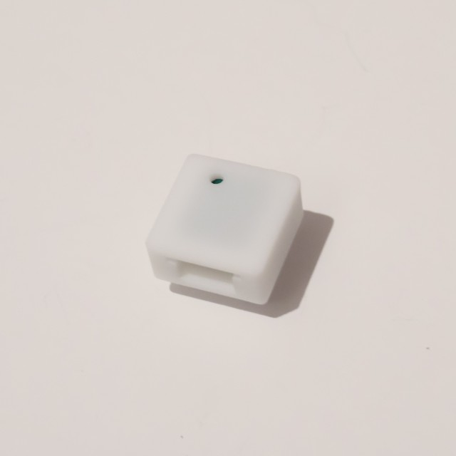
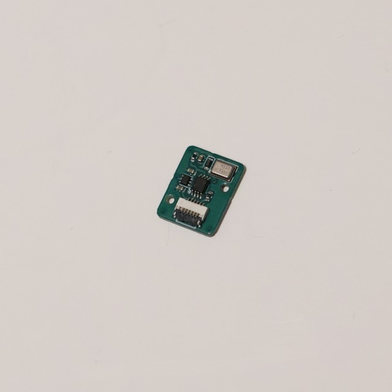

# nemu-linkマイク

[KDK-Link](https://kdk-link.pages.dev/)対応のマイクモジュールです。

自作キーボードの1Uのキーの代わりにマイクを取り付けられるほか、ケースから取り出した状態でキーボードの中に仕込むこともできます。

USBまたはnemu-link経由での入力に対応しております。**nRF52を使ってPC/スマホにBLEマイクとしてネイティブ接続することはできません**。

|||
|-|-|

## 同梱部品

- 基板
- ケース(3Dプリント品)

## 別途ご用意が必要な部品

- 6P, 0.5mmピッチFPCケーブル(同一面)
  - コネクタとモジュールを配置したい場所の距離に応じて、必要な長さのケーブルをご用意ください

## ピン配置

0.5mmピッチ、6ピンのFPCで接続します。 同一電極面のFPCを使う場合、対向する側のコネクタでピン順が反転するので注意してください。

|番号|機能|説明|
|-|-|-|
|1|VCC(3.3V)|電源|
|2|GND|シールド（オプション）|
|3|CLK|PDMのCLK|
|4|GND|シールド（オプション）|
|5|DATA|PDMのDATA|
|6|GND|電源|

## ドライバ

[ZMK用ドライバ](https://github.com/sekigon-gonnoc/zmk-driver-nemu-link-mic)